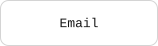
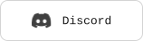
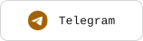
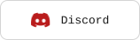
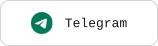
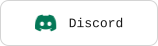
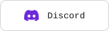

# contact

Individual contact badges. Wrap each image in a README link to your actual account.

[Getting started](../../README.md#getting-started) · [All components](../../README.md#components) · [Complete demo](../../examples/demo/README.md) · [Theme settings](../../themes/README.md) · [Minimal config](minimal.json) · [All defaults](defaults.json) · [Action inputs](action.yml)

## Use your own data

1. Add this component Action before the workflow commit step and run it once.
2. The Action creates `.github/readme/components/contact.json` automatically if missing; normal mode skips rendering on that run. The commit step saves the template.
3. Fill the generated config, add the image to README, and push to render your data.

### Minimal data config

The Action creates this template at `.github/readme/components/contact.json`; edit its sample values rather than creating the file yourself. Existing files are never overwritten.

```json
{
  "groups": [
    {
      "label": "CODE & COMMUNITY",
      "items": [
        {
          "slug": "github",
          "label": "GitHub"
        }
      ]
    }
  ]
}
```

### Action step

```yaml
- uses: GreenZV/readme-blocks/components/contact@main
```

No config path input is needed. The Action finds `.github/readme/components/contact.json` automatically. See the [main guide](../../README.md#getting-started) for the complete workflow, permissions and the commit step that saves both configs and assets.

### Add it to README

```html
<a href="https://github.com/YOUR_USERNAME">
  
</a>
```

Default output: `assets/contacts/<slug>.svg`. Text, image order, links and expandable sections remain hand-edited in README.

## Configuration

Supply your content first. Other settings are optional and inherit [defaults.json](defaults.json). Objects merge recursively; arrays replace the whole list.

| Field | Meaning |
| --- | --- |
| `groups` | Contact groups; an empty list or `{}` generates no badges. |
| `groups[].label` | Required group identifier. Visible group headings belong in README. |
| `groups[].items[].slug` | Required unique lowercase SVG filename; independent of the icon source. |
| `groups[].items[].label` | Required visible badge text. |
| `groups[].items[].icon` | Optional caller-relative SVG path or HTTPS URL; omit for a text-only badge. |
| `iconStyle / groups[].items[].iconStyle` | `original` preserves SVG colors (default); `monochrome` uses the theme logo color. An item can override the component setting. |
| `layout.minWidth / height / iconSize` | Badge size and icon dimensions. |
| `outputDirectory` | Folder for generated badge SVGs. |

The slug controls only the filename. No built-in logo lookup is performed. SVG paths resolve in your repository; HTTPS URLs are downloaded and embedded during the build. See [icon configuration](../../docs/configuration.md#icons).

URLs and email addresses belong in README hyperlinks, not in the badge config. Every badge remains individually clickable and can wrap naturally in a centered HTML paragraph.

### Customization example

Save this in the same `.github/readme/components/contact.json` file, replacing the example content with your own:

```json
{
  "groups": [
    {
      "label": "CODE & COMMUNITY",
      "items": [
        {
          "slug": "github",
          "label": "GitHub"
        }
      ]
    }
  ],
  "layout": {
    "minWidth": 176
  }
}
```

## Themes

The built-in theme is monochrome when omitted. Select another with the workflow `theme` input:

```yaml
- uses: GreenZV/readme-blocks/components/contact@main
  with:
    theme: ocean
```

Global overrides are read from `.github/readme/theme.json`. For this component only, save overrides at `.github/readme/themes/contact.json`, for example:

```json
{
  "themes": {
    "light": {
      "logo": "#0369a1"
    },
    "dark": {
      "logo": "#38bdf8"
    }
  }
}
```

Missing theme files are optional; no theme path is passed to the workflow. Resolution is rendering defaults → selected built-in theme → global overrides → component overrides. Shared typography, layout and motion are also configurable. See [theme settings](../../themes/README.md).

## Try the demo

```yaml
- uses: GreenZV/readme-blocks/components/contact@main
  with:
    demo: 'true'
```

Demo mode renders packaged [demo.json](demo.json) with normal output filenames and creates the minimal data config if missing. Stack, experience and contact demos download their icon URLs during the build. Existing data files stay unchanged and are ignored for demo rendering. The workflow commits templates and SVGs together. Theme selection and overrides still apply. Fill the generated config and remove `demo` to use your own data.

## Theme gallery

Every built-in theme appears below in light and dark mode. Gallery SVGs use explicit backgrounds and disabled animation for comparison; production SVGs remain transparent and adapt automatically. Representative items are shown; the complete demo includes the full set.

## monochrome

Workflow input: `theme: monochrome`

### Light






### Dark


## amber

Workflow input: `theme: amber`

### Light





### Dark


## crimson

Workflow input: `theme: crimson`

### Light




### Dark


## emerald

Workflow input: `theme: emerald`

### Light






### Dark


## ocean

Workflow input: `theme: ocean`

### Light


### Dark


## violet

Workflow input: `theme: violet`

### Light




### Dark


