# more-technologies

Text cards grouping additional technologies, software, and skills.

[Getting started](../../README.md#getting-started) · [All components](../../README.md#components) · [Complete demo](../../examples/demo/README.md) · [Theme settings](../../themes/README.md) · [Minimal config](minimal.json) · [All defaults](defaults.json) · [Action inputs](action.yml)

## Use your own data

1. Add this component Action before the workflow commit step and run it once.
2. The Action creates `.github/readme/components/more-technologies.json` automatically if missing; normal mode skips rendering on that run. The commit step saves the template.
3. Fill the generated config, add the image to README, and push to render your data.

### Minimal data config

The Action creates this template at `.github/readme/components/more-technologies.json`; edit its sample values rather than creating the file yourself. Existing files are never overwritten.

```json
{
  "groups": [
    {
      "label": "OTHER LANGUAGES",
      "items": [
        "Bash",
        "TypeScript"
      ]
    }
  ]
}
```

### Action step

```yaml
- uses: GreenZV/readme-blocks/components/more-technologies@main
```

No config path input is needed. The Action finds `.github/readme/components/more-technologies.json` automatically. See the [main guide](../../README.md#getting-started) for the complete workflow, permissions and the commit step that saves both configs and assets.

### Add it to README

```markdown

```

Default output: `assets/additional-experience.svg`. Text, image order, links and expandable sections remain hand-edited in README.

## Configuration

Supply your content first. Other settings are optional and inherit [defaults.json](defaults.json). Objects merge recursively; arrays replace the whole list.

| Field | Meaning |
| --- | --- |
| `groups` | Required non-empty list of categories. |
| `groups[].label` | Card heading. |
| `groups[].items` | List of plain technology or software names, displayed as text. |
| `title` | Accessible SVG title. |
| `layout.columns / gap / textPadding` | Column count, spacing between cards and inner text padding. |
| `output` | SVG output path. |

Items wrap within each card. Use stack or experience for logo rows; this component displays plain names. A final row containing one card spans the full component width.

### Customization example

Save this in the same `.github/readme/components/more-technologies.json` file, replacing the example content with your own:

```json
{
  "groups": [
    {
      "label": "OTHER LANGUAGES",
      "items": [
        "Bash",
        "TypeScript"
      ]
    }
  ],
  "layout": {
    "columns": 1,
    "gap": 20
  }
}
```

## Themes

The built-in theme is monochrome when omitted. Select another with the workflow `theme` input:

```yaml
- uses: GreenZV/readme-blocks/components/more-technologies@main
  with:
    theme: ocean
```

Global overrides are read from `.github/readme/theme.json`. For this component only, save overrides at `.github/readme/themes/more-technologies.json`, for example:

```json
{
  "themes": {
    "light": {
      "title": "#0369a1"
    },
    "dark": {
      "title": "#38bdf8"
    }
  }
}
```

Missing theme files are optional; no theme path is passed to the workflow. Resolution is rendering defaults → selected built-in theme → global overrides → component overrides. Shared typography, layout and motion are also configurable. See [theme settings](../../themes/README.md).

## Try the demo

```yaml
- uses: GreenZV/readme-blocks/components/more-technologies@main
  with:
    demo: 'true'
```

Demo mode renders packaged [demo.json](demo.json) with normal output filenames and creates the minimal data config if missing. Stack, experience and contact demos download their icon URLs during the build. Existing data files stay unchanged and are ignored for demo rendering. The workflow commits templates and SVGs together. Theme selection and overrides still apply. Fill the generated config and remove `demo` to use your own data.

## Theme gallery

Every built-in theme appears below in light and dark mode. Gallery SVGs use explicit backgrounds and disabled animation for comparison; production SVGs remain transparent and adapt automatically.

## monochrome

Workflow input: `theme: monochrome`

### Light

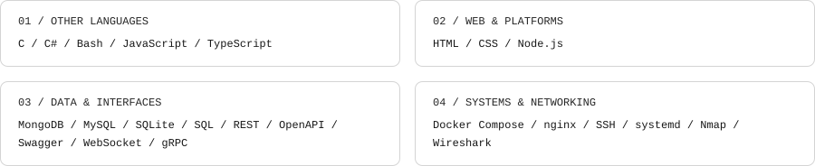

### Dark

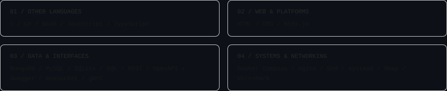

## amber

Workflow input: `theme: amber`

### Light

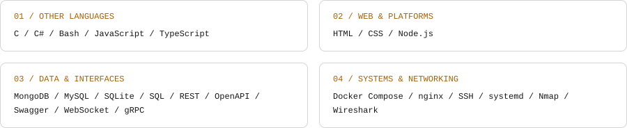

### Dark

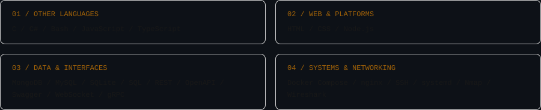

## crimson

Workflow input: `theme: crimson`

### Light


### Dark

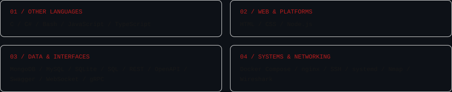

## emerald

Workflow input: `theme: emerald`

### Light

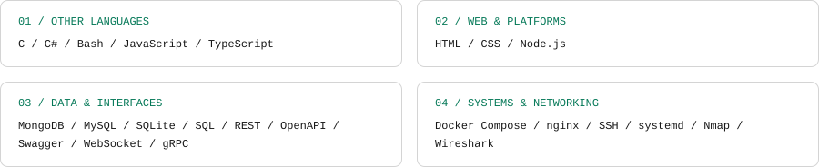

### Dark

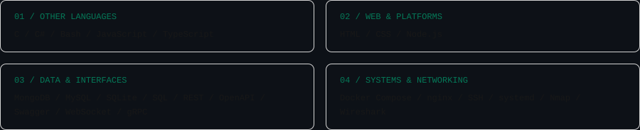

## ocean

Workflow input: `theme: ocean`

### Light

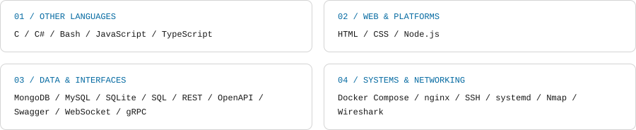

### Dark

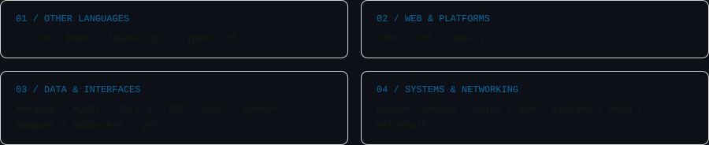

## violet

Workflow input: `theme: violet`

### Light

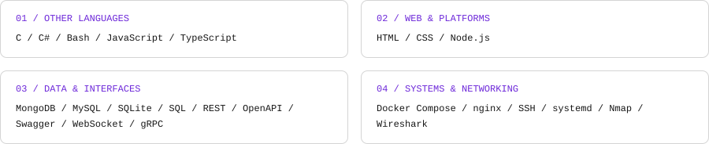

### Dark

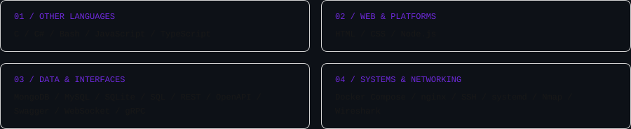

