# projects

Individual project cards with descriptions, stack labels, and configurable lifecycle statuses. Links belong in your README.

[Getting started](../../README.md#getting-started) · [All components](../../README.md#components) · [Complete demo](../../examples/demo/README.md) · [Theme settings](../../themes/README.md) · [Minimal config](minimal.json) · [All defaults](defaults.json) · [Action inputs](action.yml)

## Use your own data

1. Add this component Action before the workflow commit step and run it once.
2. The Action creates `.github/readme/components/projects.json` automatically if missing; normal mode skips rendering on that run. The commit step saves the template.
3. Fill the generated config, add the image to README, and push to render your data.

### Minimal data config

The Action creates this template at `.github/readme/components/projects.json`; edit its sample values rather than creating the file yourself. Existing files are never overwritten.

```json
{
  "items": [
    {
      "slug": "my-project",
      "title": "My project",
      "description": "What the project does.",
      "stack": [
        "Java",
        "Spring Boot"
      ],
      "status": "in-development"
    }
  ]
}
```

### Action step

```yaml
- uses: GreenZV/readme-blocks/components/projects@main
```

No config path input is needed. The Action finds `.github/readme/components/projects.json` automatically. See the [main guide](../../README.md#getting-started) for the complete workflow, permissions and the commit step that saves both configs and assets.

### Add it to README

```html
<a href="https://github.com/OWNER/REPOSITORY">
  <picture>
  <source media="(prefers-color-scheme: dark)" srcset="assets/projects/my-project.dark.svg">
  <source media="(prefers-color-scheme: light)" srcset="assets/projects/my-project.light.svg">
  
</picture>
</a>
```

Default output: `assets/projects/<slug>.svg`. The build also writes matching `.light.svg` and `.dark.svg` variants. The default appearance is auto; use the picture markup above to follow the selected GitHub theme. A fixed appearance configured below also works with the same markup. Text, image order, links and expandable sections remain hand-edited in README.

## Configuration

Supply your content first. Other settings are optional and inherit [defaults.json](defaults.json). Objects merge recursively; arrays replace the whole list.

| Field | Meaning |
| --- | --- |
| `items` | Project list. Use an empty array or `{}` to generate no cards. |
| `items[].slug / title` | Required unique lowercase slug and project title. The slug determines the SVG filename. |
| `items[].description / stack` | Optional description and list of technology labels. |
| `items[].status` | Optional ID from `statuses`; omit it or use `null` to hide the status. |
| `items[].showLinkHint` | Optional `view project ->` footer. It does not create a hyperlink. |
| `statuses` | Status definitions with a `label` and a palette `tone`. |
| `layout / outputDirectory` | Card dimensions, text limits and the output folder. |

Built-in status IDs are `planned`, `in-development`, `completed`, `maintained`, `on-hold`, `experimental` and `archived`. Statuses are configured manually and are independent of CI/CD.

Available tones are `title`, `body`, `muted`, `success` and `pending`. Override one label to retain its default tone, or add a new status with both fields. The dot uses the tone; the status text stays neutral.

There is no fixed card-count limit. Add each generated card and its repository link to README manually. Remove obsolete SVGs and README entries when removing projects.

### Customization example

Save this in the same `.github/readme/components/projects.json` file, replacing the example content with your own:

```json
{
  "items": [
    {
      "slug": "my-project",
      "title": "My project",
      "description": "What the project does.",
      "stack": [
        "Java",
        "Spring Boot"
      ],
      "status": "in-development"
    }
  ],
  "statuses": {
    "in-development": {
      "label": "Building"
    }
  }
}
```

## Themes

The built-in theme is monochrome when omitted. Select another with the workflow `theme` input:

```yaml
- uses: GreenZV/readme-blocks/components/projects@main
  with:
    theme: ocean
```

Global overrides are read from `.github/readme/theme.json`. For this component only, save overrides at `.github/readme/themes/projects.json`, for example:

```json
{
  "themes": {
    "light": {
      "title": "#0369a1"
    },
    "dark": {
      "title": "#38bdf8"
    }
  }
}
```

Missing theme files are optional; no theme path is passed to the workflow. Resolution is rendering defaults → selected built-in theme → global overrides → component overrides. Shared appearance, typography, layout and motion are also configurable. See [theme settings](../../themes/README.md).

### Light and dark appearance

Both appearances are enabled by default (`appearance: auto`). To pin this component to dark colors, add this optional setting to `.github/readme/themes/projects.json` alongside any existing overrides:

```json
{
  "appearance": "dark"
}
```

Use `light` for light colors or `auto` for automatic switching. The same key in `.github/readme/theme.json` sets the global default. This is independent of the named color palette and is not a workflow input or a content field. In fixed modes all three SVG filenames use the chosen appearance, so the README markup above does not need to change. See [appearance settings and manual integration](../../docs/appearance.md) for single-image alternatives and direct generation.

## Try the demo

```yaml
- uses: GreenZV/readme-blocks/components/projects@main
  with:
    demo: 'true'
```

Demo mode renders packaged [demo.json](demo.json) with normal output filenames and creates the minimal data config if missing. Stack, experience and contact demos download their icon URLs during the build. Existing data files stay unchanged and are ignored for demo rendering. The workflow commits templates and SVGs together. Theme selection and overrides still apply. Fill the generated config and remove `demo` to use your own data.

## Theme gallery

Every built-in theme appears below in light and dark mode. Gallery SVGs use explicit backgrounds and disabled animation for comparison; production SVGs remain transparent. The original SVG uses browser color preferences; the explicit variants follow the GitHub theme through the picture markup above. Representative items are shown; the complete demo includes the full set.

## monochrome

Workflow input: `theme: monochrome`

### Light

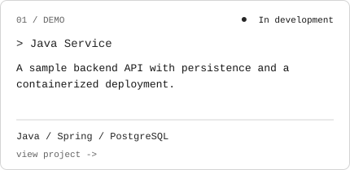

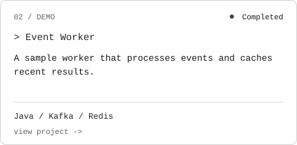

### Dark

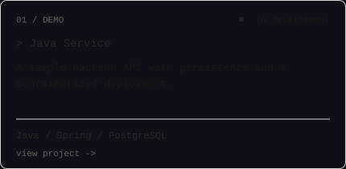

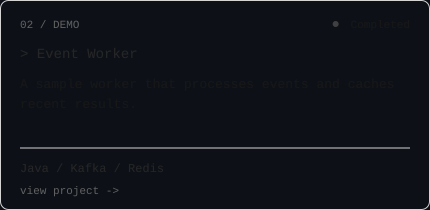

## amber

Workflow input: `theme: amber`

### Light

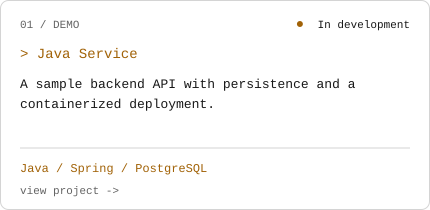

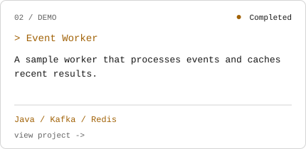

### Dark

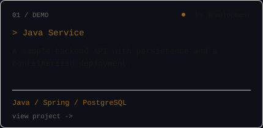

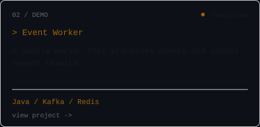

## crimson

Workflow input: `theme: crimson`

### Light

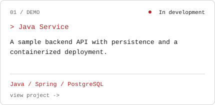

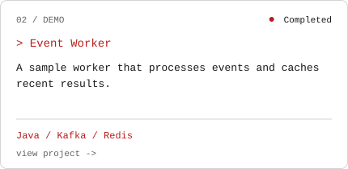

### Dark

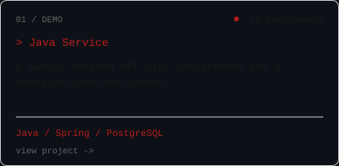

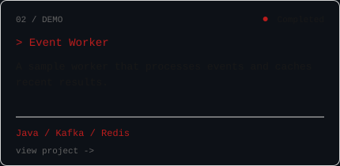

## emerald

Workflow input: `theme: emerald`

### Light

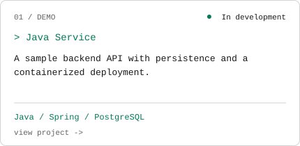

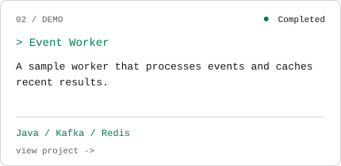

### Dark

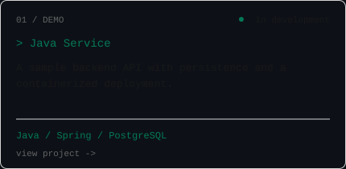

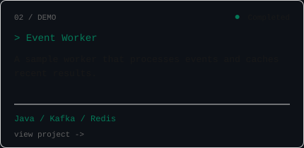

## ocean

Workflow input: `theme: ocean`

### Light

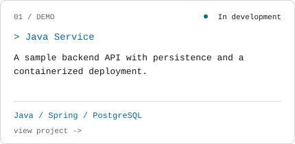

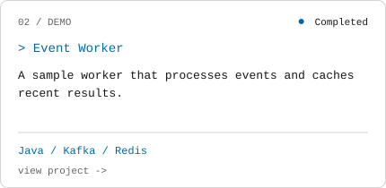

### Dark

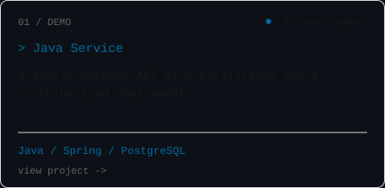

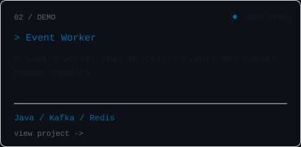

## violet

Workflow input: `theme: violet`

### Light

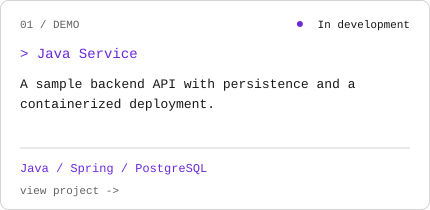

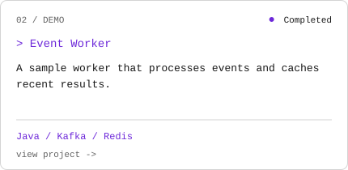

### Dark

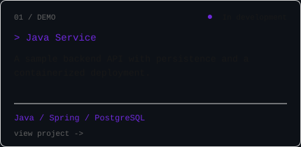

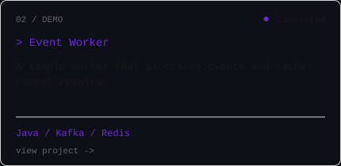

