<picture>
  <source media="(prefers-color-scheme: dark)" srcset="assets/banner.dark.svg">
  <source media="(prefers-color-scheme: light)" srcset="assets/banner.light.svg">
  
</picture>

# README components — demo

A complete example using the built-in **monochrome** theme. All names, projects,
skills and activity below are demonstration data, not a developer's actual profile.
The picture elements select explicit light or dark SVGs for your GitHub theme.
Each Action generates these variants alongside the original adaptive SVG.
Both appearances are enabled by default (`appearance: auto`). You can pin a
light or dark appearance globally or per component through the fixed theme
configs; see [appearance settings and manual markup](../../docs/appearance.md).

## Available themes

<!-- readme-blocks:themes:start -->

| Theme | Light accent | Dark accent | Banner preview |
| --- | --- | --- | --- |
| [monochrome](../../themes/monochrome.json) | `#262626` | `#e5e5e5` | [Preview](../../components/banner/README.md#monochrome) |
| [amber](../../themes/amber.json) | `#a16207` | `#fbbf24` | [Preview](../../components/banner/README.md#amber) |
| [crimson](../../themes/crimson.json) | `#b91c1c` | `#f87171` | [Preview](../../components/banner/README.md#crimson) |
| [emerald](../../themes/emerald.json) | `#047857` | `#34d399` | [Preview](../../components/banner/README.md#emerald) |
| [ocean](../../themes/ocean.json) | `#0369a1` | `#38bdf8` | [Preview](../../components/banner/README.md#ocean) |
| [violet](../../themes/violet.json) | `#6d28d9` | `#a78bfa` | [Preview](../../components/banner/README.md#violet) |

<!-- readme-blocks:themes:end -->

Browse [component pages](../../README.md#components) to compare every built-in
theme, or read about [automatic theme overrides](../../themes/README.md).

Keep the components you need, change their order, and edit this README manually.
You can replace demo data later without changing the standard asset paths.

## Current focus

<picture>
  <source media="(prefers-color-scheme: dark)" srcset="assets/now.dark.svg">
  <source media="(prefers-color-scheme: light)" srcset="assets/now.light.svg">
  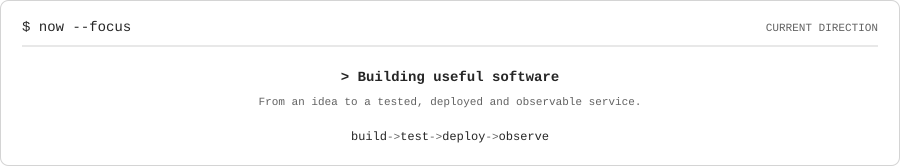
</picture>

## Contribution calendar

<picture>
  <source media="(prefers-color-scheme: dark)" srcset="assets/contributions.dark.svg">
  <source media="(prefers-color-scheme: light)" srcset="assets/contributions.light.svg">
  
</picture>

The calendar is generated offline from a fixed seed. It does not fetch or claim
anyone's GitHub activity.

## Projects

Sample links lead to GitHub. Replace them with your repository URLs.

<table>
  <tr>
    <td><a href="https://github.com/"><picture>
  <source media="(prefers-color-scheme: dark)" srcset="assets/projects/demo-java-service.dark.svg">
  <source media="(prefers-color-scheme: light)" srcset="assets/projects/demo-java-service.light.svg">
  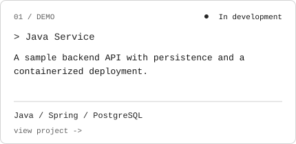
</picture></a></td>
    <td><a href="https://github.com/"><picture>
  <source media="(prefers-color-scheme: dark)" srcset="assets/projects/demo-event-worker.dark.svg">
  <source media="(prefers-color-scheme: light)" srcset="assets/projects/demo-event-worker.light.svg">
  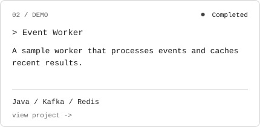
</picture></a></td>
  </tr>
  <tr>
    <td><a href="https://github.com/"><picture>
  <source media="(prefers-color-scheme: dark)" srcset="assets/projects/demo-deployment-kit.dark.svg">
  <source media="(prefers-color-scheme: light)" srcset="assets/projects/demo-deployment-kit.light.svg">
  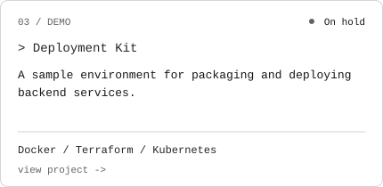
</picture></a></td>
    <td><a href="https://github.com/"><picture>
  <source media="(prefers-color-scheme: dark)" srcset="assets/projects/demo-observability-lab.dark.svg">
  <source media="(prefers-color-scheme: light)" srcset="assets/projects/demo-observability-lab.light.svg">
  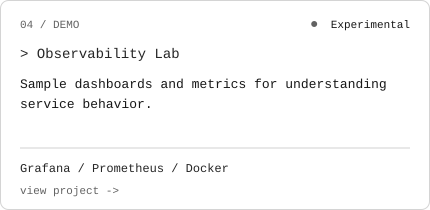
</picture></a></td>
  </tr>
  <tr>
    <td><a href="https://github.com/"><picture>
  <source media="(prefers-color-scheme: dark)" srcset="assets/projects/demo-api-contracts.dark.svg">
  <source media="(prefers-color-scheme: light)" srcset="assets/projects/demo-api-contracts.light.svg">
  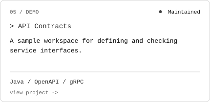
</picture></a></td>
    <td><a href="https://github.com/"><picture>
  <source media="(prefers-color-scheme: dark)" srcset="assets/projects/demo-backend-utilities.dark.svg">
  <source media="(prefers-color-scheme: light)" srcset="assets/projects/demo-backend-utilities.light.svg">
  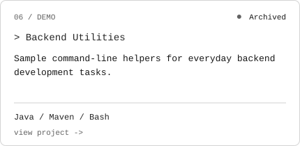
</picture></a></td>
  </tr>
</table>

## Stack

<picture>
  <source media="(prefers-color-scheme: dark)" srcset="assets/stack.dark.svg">
  <source media="(prefers-color-scheme: light)" srcset="assets/stack.light.svg">
  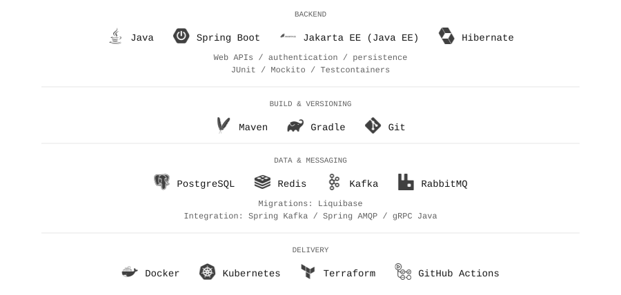
</picture>

## Experience

<picture>
  <source media="(prefers-color-scheme: dark)" srcset="assets/experience.dark.svg">
  <source media="(prefers-color-scheme: light)" srcset="assets/experience.light.svg">
  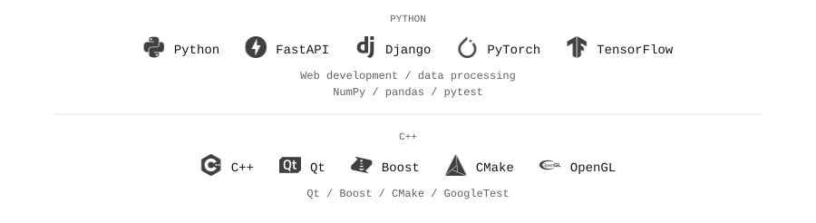
</picture>

## Toolbox

<picture>
  <source media="(prefers-color-scheme: dark)" srcset="assets/toolbox.dark.svg">
  <source media="(prefers-color-scheme: light)" srcset="assets/toolbox.light.svg">
  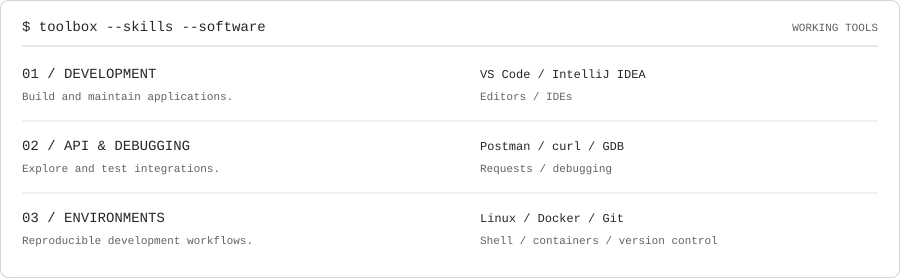
</picture>

## Other technologies

<picture>
  <source media="(prefers-color-scheme: dark)" srcset="assets/additional-experience.dark.svg">
  <source media="(prefers-color-scheme: light)" srcset="assets/additional-experience.light.svg">
  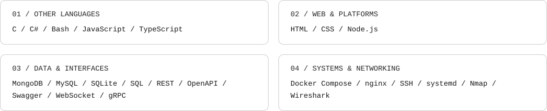
</picture>

## Contact

Example platforms only. Wrap the images you want in your own links and remove the rest.

<picture>
  <source media="(prefers-color-scheme: dark)" srcset="assets/contacts/email.dark.svg">
  <source media="(prefers-color-scheme: light)" srcset="assets/contacts/email.light.svg">
  
</picture>
<picture>
  <source media="(prefers-color-scheme: dark)" srcset="assets/contacts/telegram.dark.svg">
  <source media="(prefers-color-scheme: light)" srcset="assets/contacts/telegram.light.svg">
  
</picture>
<picture>
  <source media="(prefers-color-scheme: dark)" srcset="assets/contacts/discord.dark.svg">
  <source media="(prefers-color-scheme: light)" srcset="assets/contacts/discord.light.svg">
  
</picture>
<picture>
  <source media="(prefers-color-scheme: dark)" srcset="assets/contacts/linkedin.dark.svg">
  <source media="(prefers-color-scheme: light)" srcset="assets/contacts/linkedin.light.svg">
  
</picture>
<picture>
  <source media="(prefers-color-scheme: dark)" srcset="assets/contacts/github.dark.svg">
  <source media="(prefers-color-scheme: light)" srcset="assets/contacts/github.light.svg">
  
</picture>
<picture>
  <source media="(prefers-color-scheme: dark)" srcset="assets/contacts/gitlab.dark.svg">
  <source media="(prefers-color-scheme: light)" srcset="assets/contacts/gitlab.light.svg">
  
</picture>
<picture>
  <source media="(prefers-color-scheme: dark)" srcset="assets/contacts/leetcode.dark.svg">
  <source media="(prefers-color-scheme: light)" srcset="assets/contacts/leetcode.light.svg">
  
</picture>
<picture>
  <source media="(prefers-color-scheme: dark)" srcset="assets/contacts/codeforces.dark.svg">
  <source media="(prefers-color-scheme: light)" srcset="assets/contacts/codeforces.light.svg">
  
</picture>
<picture>
  <source media="(prefers-color-scheme: dark)" srcset="assets/contacts/stackoverflow.dark.svg">
  <source media="(prefers-color-scheme: light)" srcset="assets/contacts/stackoverflow.light.svg">
  
</picture>
<picture>
  <source media="(prefers-color-scheme: dark)" srcset="assets/contacts/x.dark.svg">
  <source media="(prefers-color-scheme: light)" srcset="assets/contacts/x.light.svg">
  
</picture>
<picture>
  <source media="(prefers-color-scheme: dark)" srcset="assets/contacts/facebook.dark.svg">
  <source media="(prefers-color-scheme: light)" srcset="assets/contacts/facebook.light.svg">
  
</picture>
<picture>
  <source media="(prefers-color-scheme: dark)" srcset="assets/contacts/mastodon.dark.svg">
  <source media="(prefers-color-scheme: light)" srcset="assets/contacts/mastodon.light.svg">
  
</picture>
<picture>
  <source media="(prefers-color-scheme: dark)" srcset="assets/contacts/devdotto.dark.svg">
  <source media="(prefers-color-scheme: light)" srcset="assets/contacts/devdotto.light.svg">
  
</picture>
<picture>
  <source media="(prefers-color-scheme: dark)" srcset="assets/contacts/medium.dark.svg">
  <source media="(prefers-color-scheme: light)" srcset="assets/contacts/medium.light.svg">
  
</picture>
<picture>
  <source media="(prefers-color-scheme: dark)" srcset="assets/contacts/website.dark.svg">
  <source media="(prefers-color-scheme: light)" srcset="assets/contacts/website.light.svg">
  
</picture>
<picture>
  <source media="(prefers-color-scheme: dark)" srcset="assets/contacts/codewars.dark.svg">
  <source media="(prefers-color-scheme: light)" srcset="assets/contacts/codewars.light.svg">
  
</picture>

## Use this example

Copy this README into your profile repository. Use the component steps from
[workflow.yml](workflow.yml), keeping only the ones you need. The example uses `GreenZV/readme-blocks@main`.

On the first run, each Action creates its minimal config automatically at
`.github/readme/components/<component>.json` when missing. The workflow saves these
templates together with the demo SVGs; existing configs are never overwritten.

To switch to your own data, fill in the generated configs and remove `demo: 'true'`
from those Action steps. If no other inputs remain, remove the `with` block too.
Config paths are discovered automatically and are not workflow inputs. Adjust
README image paths when changing project or contact slugs. Follow the
[main setup and configuration guide](../../README.md#configure-your-data) and each
[component's instructions](../../README.md#components) for details.

### Demo icon sources

Stack, experience and contact configs reference version-pinned HTTPS SVG URLs.
The build downloads icons into memory and embeds them in the generated images;
no standalone logo files are included in the library. These demos require network
access when building, while the completed README images are self-contained.
Email and website demonstrate badges without an icon. Your own configs can use
local SVG paths or HTTPS URLs; see [icon configuration](../../docs/configuration.md#icons).
